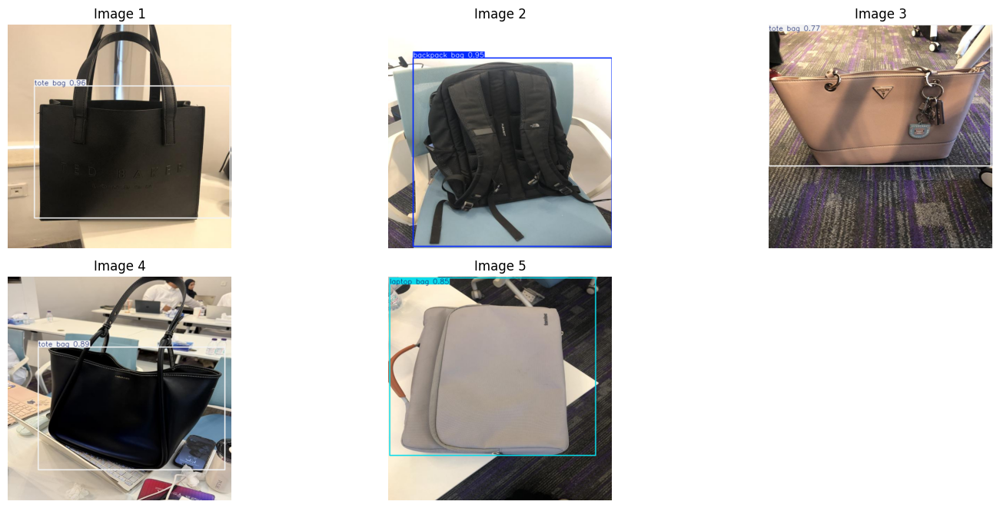

# Bag Detection with YOLOv8

A computer vision task from the Tuwaiq Data Science & AI Bootcamp. The notebook fine-tunes a pretrained YOLOv8n model to locate three types of bags in images: backpacks, laptop bags, and tote bags.



## Members
- [Nouf](https://github.com/supernofa)
- [Razan](https://github.com/Razan-2)
- [Raghad](https://github.com/Raghad5MH)
- [Shaden](https://github.com/ShadenAlrshoud)

## Dataset and training

The notebook downloads version 7 of the [Roboflow Bags Detection dataset](https://universe.roboflow.com/birdstriketeam/bags-detection-ztrkp/dataset/7) in YOLOv8 format. The export used in the recorded run contained 93 training images after augmentation, 9 validation images, and 5 test images.

Training starts from `yolov8n.pt` and uses 100 epochs, a 640-pixel image size, a batch size of 8, and mosaic augmentation. The notebook evaluates the detector on the test split, generates evaluation plots, and visualizes test predictions at a confidence threshold of 0.25.

## Recorded test results

| Metric | Score |
|---|---:|
| Precision | 0.950 |
| Recall | 0.922 |
| mAP@50 | 0.995 |
| mAP@50–95 | 0.551 |

The scores come from the original notebook run on five test images. The lower mAP at stricter IoU thresholds indicates that precise bounding-box placement was harder than detection at IoU 0.50. The small test set limits what these scores tell us about performance on new images.

## Run the notebook

From the repository root, install the dependencies and launch JupyterLab.

```bash
python -m pip install -r requirements.txt
python -m jupyterlab
```

Open [Task_bags_detection.ipynb](Task_bags_detection.ipynb) and run the cells in order. The first cell reads `ROBOFLOW_API_KEY` from the environment or prompts for it privately. Use a Roboflow key with access to the dataset. The first run requires internet access to download the dataset and pretrained weights. A GPU is recommended for training.

Ultralytics saves training outputs, evaluation plots, and annotated predictions under `runs/`. The repository includes the notebook and a sample prediction image. The dataset and model weights download when you run the notebook.
